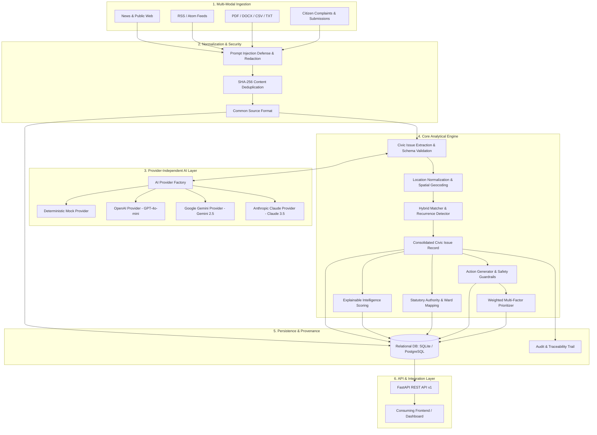

# Civic Issue Discovery & Action Engine - System Architecture

## 1. Architectural Overview

The **Civic Issue Discovery, Intelligence, and Action Generation Engine** is a modular, provider-independent backend system engineered to transform raw, unstructured civic data into corroborated civic intelligence, statutory accountability maps, and safe, actionable volunteer initiatives.

---

## 2. Component Breakdown

### 2.1 Source Ingestion & Normalization
- **Connectors**:
  - `WebPageConnector`: Retrieves public news and reports via HTTP with timeouts and standard civic bot User-Agent headers. Strips boilerplate and scripts via BeautifulSoup.
  - `RSSFeedConnector`: Parses RSS/Atom syndication feeds via `feedparser`.
  - `FileUploadConnector`: Handles binary payloads (`.pdf` via `pypdf`, `.docx` via `python-docx`, `.csv` via Python CSV engine, `.txt`/`.md`).
  - `DirectTextConnector`: Accepts raw text and formatted complaints.
- **Idempotency & Deduplication**:
  - Normalized text is hashed using SHA-256 (`content_hash`).
  - If a document with identical hash already exists, the engine flags it as duplicate and prevents duplicate record storms.

### 2.2 Security & Prompt-Injection Defense
- Untrusted content is wrapped in `<untrusted_source_content>` tags with strict directives commanding the model to treat content purely as passive evidentiary input.
- Regex heuristics actively detect and neutralize instruction breakout attempts (e.g., `ignore previous instructions`, `system prompt override`).
- Sensitive PII and delimiter attempts are safely stripped prior to LLM processing.

### 2.3 Provider-Independent AI Architecture
All AI interactions implement the `BaseAIProvider` interface:
1. `analyze_source(source_text, metadata)`
2. `extract_civic_issues(source_text, metadata)`
3. `classify_issue(issue_description)`
4. `find_related_issues(target_issue, candidate_issues)`
5. `identify_stakeholders(issue_data, jurisdiction_info)`
6. `generate_civic_action(issue_data, context)`
7. `evaluate_evidence(issue_data, evidence_items)`

Supports seamless switching via `AI_PROVIDER` (`openai`, `gemini`, `anthropic`, `mock`) with configurable timeouts, retries with exponential backoff, and strict Pydantic output validation.

### 2.4 Hybrid Issue Matching & Deduplication Engine
Compares observations across 5 distinct relationship dimensions:
1. **Category Compatibility**: Mismatched categories are immediately flagged as `UNRELATED_KEYWORD_MATCH`.
2. **Text Semantic Similarity**: TF-IDF cosine similarity evaluates problem descriptions.
3. **Geographic Proximity**: Calculates great-circle distance using the **Haversine formula**.
   - `< 0.6 km`: Identical facility/junction.
   - `0.6 - 3.5 km`: Nearby neighborhood/corridor.
   - `> 3.5 km`: Separate municipal area.
4. **Temporal Proximity**:
   - `delta <= 14 days` at same facility: `DUPLICATE_REPORT`.
   - `delta > 14 days` at same facility: `RECURRING_INCIDENT` (chronic problem).
5. **Consolidation**: Observations meeting merge criteria update the consolidated issue record, increasing observation counts and updating distinct publisher corroboration while preserving 100% of the raw evidence.

### 2.5 Explainable Civic Intelligence & Multi-Factor Scoring
Scores are computed transparently on a 1.0 to 10.0 scale:
- **Severity Score**: Assesses base danger and reported consequences (hospitalizations, vehicle accidents, flooding).
- **Urgency Score**: Assesses imminent public disruption.
- **Recurrence Score**: Distinguishes acute single events from chronic issues spanning weeks/months.
- **Evidence Strength**: Calculated from distinct publisher counts and verified verbatim quotes.
- **Community Impact**: Estimated volume of impacted commuters/residents.
- **Actionability**: Feasibility of safe citizen participation.
- **Composite Priority Score (0 - 100)**:
  $$\text{Priority} = 10 \times \sum (w_i \times \text{Score}_i)$$

### 2.6 Authority & Stakeholder Discovery (Anti-Hallucination)
- Uses an extensible registry of verified municipal bodies (e.g. BMC, TMC, NMMC, MPCB, Mumbai Traffic Police, Praja Foundation).
- If an entity is verified in the registry, it is labeled `VERIFIED_REGISTRY` with real public helplines and portals.
- If an entity is recommended by AI without verified registry backing, it is marked `CANDIDATE_UNVERIFIED` and contact numbers are strictly omitted to prevent hallucinated phone numbers.

### 2.7 Civic Action Generator & Safety Guardrails
Generates structured volunteer initiatives:
- **Safety Policy**:
  - High-risk activities (electrical, sewage entry, direct confrontation) are flagged as `HIGH_REQUIRES_AUTHORITY` and held for human review.
  - Safe activities (sidewalk photo audits, RWA surveys, official portal complaint logging) are recommended with step-by-step instructions.
- **Human Moderation**:
  - Actions feature a formal review state (`PENDING_REVIEW`, `APPROVED`, `REJECTED`, `MODIFIED`) with audit tracking.
